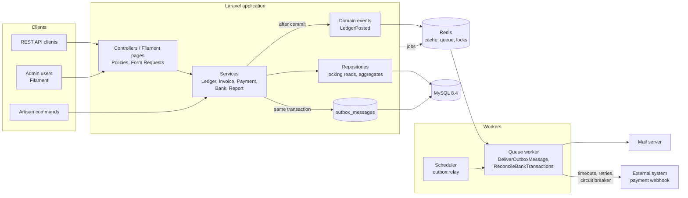
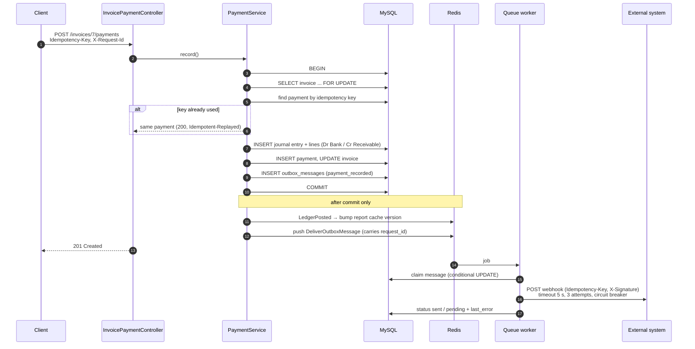
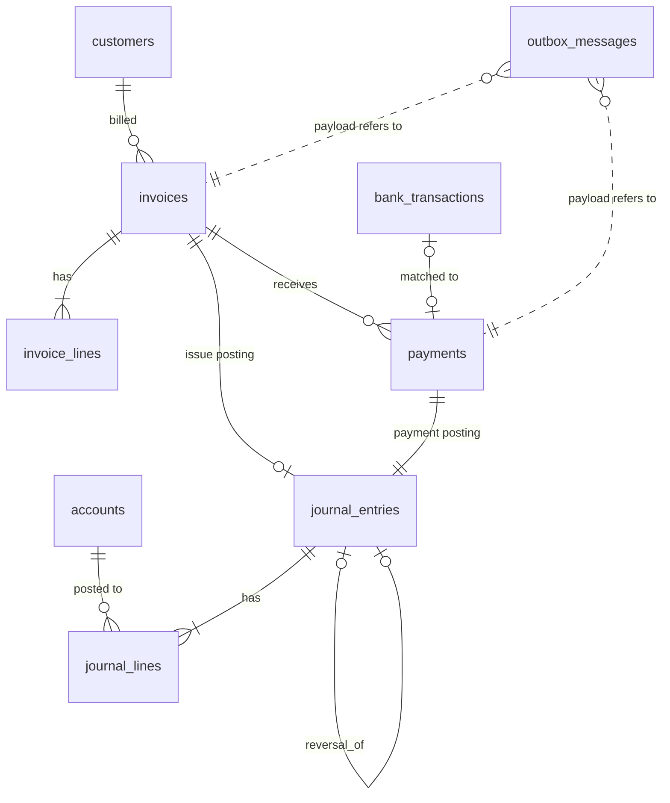

# Architecture

A layered, modular monolith: one deployable Laravel application, one MySQL
database, Redis for cache and queues. Why not services: [ADR 0003](adr/0003-modular-monolith.md).

## Components

## Modules

The code is split by layer (`Services`, `Repositories`, `Http`), and the
services fall into three modules with one-way dependencies:

| Module | Classes | Depends on |
|---|---|---|
| Ledger | `LedgerService`, `ChartOfAccounts`, `SequenceService`, `ReportService`, `Reports\*` | — |
| Billing | `InvoiceService`, `PaymentService`, `Outbox\*` | Ledger |
| Banking | `BankStatementImporter`, `BankReconciler`, `ReconcileBankTransactions` | Billing (matches bank lines to payments) |

Ledger knows nothing about invoices: a posting carries an optional `source`
(polymorphic), and the ledger's own consumers react to `LedgerPosted`.

## Recording a payment

The write path that touches most of the design decisions.

What each step protects against:

| Step | Protects against | Details |
|---|---|---|
| 4 | Two requests paying the same invoice at once | [ADR 0004](adr/0004-locking-and-idempotency.md) |
| 5 | A client retrying after a timeout | [ADR 0004](adr/0004-locking-and-idempotency.md) |
| 7 | An unbalanced or edited ledger | [ADR 0001](adr/0001-money-as-integer-minor-units.md), [ADR 0002](adr/0002-append-only-ledger.md) |
| 9 | A payment without its notification, or a notification for a rolled-back payment | [ADR 0005](adr/0005-transactional-outbox.md) |
| 11 | A stale trial balance | [ADR 0006](adr/0006-report-cache-invalidation.md) |
| 16 | A slow or failing receiver | [ADR 0007](adr/0007-outbound-webhook-resilience.md) |
| 1, 12 | Losing track of a request across processes | [ADR 0008](adr/0008-request-correlation-and-json-logs.md) |

## Core data model

Column-level documentation is in the database itself: every column has a
comment (`SHOW FULL COLUMNS FROM invoices`).

## Runtime (Docker)

| Service | Image | Role |
|---|---|---|
| `app` | `Dockerfile` target `app` (PHP 8.4 FPM, OPcache) | HTTP requests |
| `web` | target `web` (Nginx with `public/` baked in) | Static files, proxies PHP to `app:9000` |
| `queue` | same image as `app` | `queue:work redis` |
| `scheduler` | same image as `app` | `schedule:work` (`outbox:relay` every 5 minutes) |
| `mysql` | `mysql:8.4` | Data |
| `redis` | `redis:7-alpine` | Cache (db 1), queue and locks (db 0) |
| `mailpit` | `axllent/mailpit` | Catches outgoing email |

Operations: [operations.md](operations.md).
